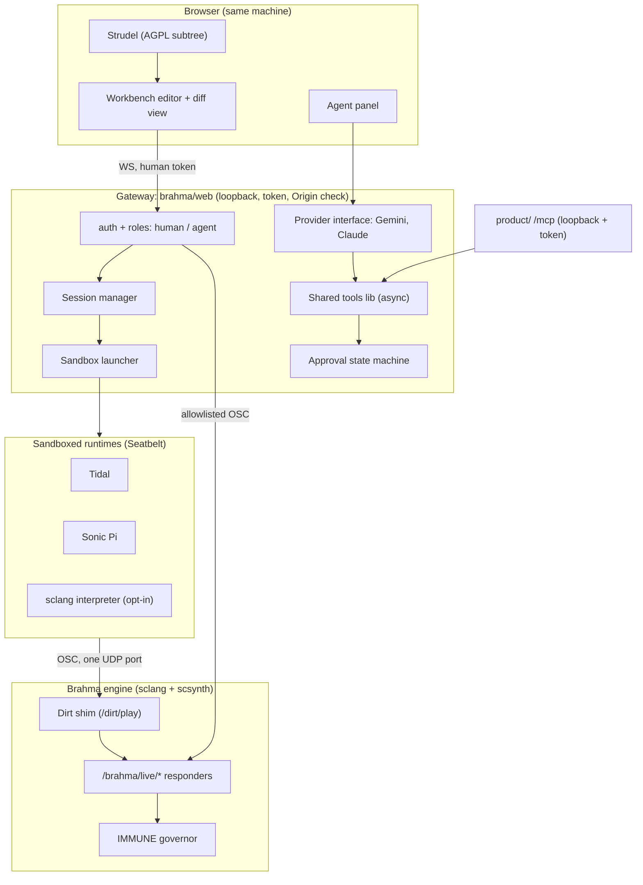

# Plan: Browser live-coding workbench + AI composition for Brahma

Date: 2026-10-22 · Branch: `feat/brahma-live-workbench` · Lane: `feat(brahma):` (gateway + workbench), with a small `product/` reuse.
Supersedes the two conversation drafts (v1 Tidal/Sonic Pi front-ends, v2 browser + AI). This file is the canonical copy.

## 0. Decisions (from the owner)

| Topic | Decision |
|---|---|
| Strudel | Use it. Document **and satisfy** its licence obligations for the actual integration (see §3). |
| Browser | Same machine as Brahma. Remote audio streaming is deferred. |
| Models | Gemini and Claude behind a provider interface. Credentials stay server-side and reuse existing configuration. |
| Agent auto-run | Off. *Accepting* an edit and *executing* it are separate actions (see §5). |
| Tool ownership | One shared implementation in the local gateway, reused by `product/`. Local tools are unmetered. Model-provider charges still apply. |
| Verification | Browser-to-runtime execution, audible output, error reporting, stop-all. Report **implemented / tested / observed** separately. |

## 1. What the code actually does today (inspected, not assumed)

| Surface | Finding | Consequence |
|---|---|---|
| `product/src/api/mcp.js` | Streamable-HTTP JSON-RPC. `tools/call` runs `action.handler(args)` **synchronously** and checks `action.cost` against an API key. It has no async, no per-tool scope, no streaming. | The shared tools need async handlers. `mcp.js` must `await`. Cost 0 means *no authentication at all*. |
| `product/src/api/acp.js` | `session/prompt` and `/acp/runs` route the prompt text through a **regex** `interpret()` to a single action. There is no LLM, no tool loop and no permission request. | ACP cannot host an agent loop. The loop lives in the gateway. **ACP reuse is deferred** (see §7). |
| `product/server.js` | CORS `Access-Control-Allow-Origin: *`, `listen(PORT)` with no host (all interfaces), JSON-RPC unauthenticated for cost-0 tools. | Local live-control tools **must not** be registered here by default. They need loopback, a token and an Origin check. |
| `brahma/web/server.js` | WebSocket-to-OSC bridge. It has an address-prefix allowlist, but it binds `0.0.0.0` and has **no token and no Origin check**. Any web page can send OSC to SuperCollider (cross-site WebSocket hijack). | This is a pre-existing exposure. The hardened gateway closes it. |
| `brahma/sc/16_engine_responders.scd` | Real trigger API: `/brahma/engine/noteOn <engine> <instance> <note> <vel> [param val…]`, `noteOff`, `set`, `setOutBus`, `freeAll <instance>`. Unknown engines only `postln`, so there is **no error reply**. There is no global stop-all. | I add a `/brahma/live/*` responder set with an error reply channel, auto-release and a real `panic` (see §4). |
| `loader.scd` | The IMMUNE governor is deployed last, only on buses 0 and 1. | Panic must **never** call `s.freeAll`, because that would kill the governor. |
| `tools/smoke.sh` | A 6-section harness. It boots `brahma/web/server.js` and expects `/` and `/api/modules` to return 200. | New checks are added to it. Existing behaviour is kept. |
| Open PR #47 (`fix/security-findings-20260916`, Codex) | Rewrites `product/src/api/acp.js`, `auth/metering.js`, `rest.js`, `brahma/web/package.json` and others. It is currently `CONFLICTING`. | Another agent's workstream. I do not touch its branch or files. I avoid `acp.js`/`metering.js`, and expect a `package.json` conflict at merge time. |
| Dependabot PRs #52/#53/#54 | Touch `brahma/web` and `product` lockfiles. | Same merge-time conflict class. Resolve by rebase, not by pre-empting. |

Local toolchain: Node 26, SuperCollider 3.x (`/Applications/Supercollider/SuperCollider.app/Contents/MacOS/sclang`, not on PATH), ffmpeg, python3, `/usr/bin/sandbox-exec`. **Not installed:** GHC/Tidal and Sonic Pi. Credentials: `GEMINI_API_KEY` and `GOOGLE_API_KEY` are set, `ANTHROPIC_API_KEY` is not.

## 2. Architecture



## 3. Strudel licensing: what is actually required

Source read: Strudel's [*Using Strudel in your Project*](https://strudel.cc/technical-manual/project-start/) (`website/src/pages/technical-manual/project-start.mdx`). Its stated terms, summarized:

1. AGPL-3.0: keep change records and dates; license derivative work under the same licence; **source must be distributed along with web publication**.
2. "The whole application must be shared under the same free/open source license, or one compatible with it." Integrating Strudel with code that has **no compatible FOSS licence is not permitted**.
3. This also covers *clones informed by reading Strudel's source*, which count as derivative works.

Consequences for this repo, which is MIT:

| Obligation | How the plan satisfies it |
|---|---|
| Whole application under a compatible licence | MIT is AGPL-compatible. The workbench page is a combined work, so **everything served on it** is AGPL-3.0-or-later compatible. The subtree `brahma/web/public/workbench/` is licensed **AGPL-3.0-or-later** (SPDX header on each file, `LICENSE` copy in the folder). Allowed third-party code on that page: MIT/BSD/Apache-2.0/LGPL only (CodeMirror is MIT). **No p5.js, no Pd-embedded or proprietary assets on that page.** Cortex stays a link, not an embed. |
| No proprietary combination | `product/` (billing, marketplace, metering) is **never** served alongside Strudel and **never** bundles it. Strudel is loaded only by the local gateway. The `product/` tools are server-side code and send no Strudel to browsers. |
| Source with web publication | The workbench footer carries a permanent **Source** link. `GET /workbench/source.json` returns the repo URL, the exact commit SHA of the running checkout, the Strudel package name and pinned version, and its Codeberg URL. `NOTICE` lists Strudel, CodeMirror and every bundled package with licence and version. |
| Change records | If any Strudel file is modified (the plan is to modify none), a `CHANGES` file records file, change and date. Only the unmodified published npm artefact is served. |
| No clone informed by reading source | **No home-grown mini-notation.** Pattern evaluation is Strudel's own code. |
| Naming | The product name does not contain "Strudel". The UI says "Strudel pattern language" (nominative use). |
| Pinned version | `@strudel/web` is pinned to an exact version in `package.json`. The lockfile and `NOTICE` record it. |
| Repo-level declaration | `LICENSES/AGPL-3.0-or-later.txt` is added. The README and `ORGANS.md` state the subtree boundary. |
| Residual legal uncertainty | This is engineering diligence, **not legal advice**. If `product/` or the workbench ever ships as a hosted commercial service, the licence position needs your review first. I record this as an open item and do not decide it. |

## 4. Engine side (SuperCollider)

New `brahma/sc/31_live_gateway.scd`, loaded after `16_engine_responders.scd`. It does not touch the governor.

| OSC | Behaviour |
|---|---|
| `/brahma/live/play <engine> <instance> <note> <vel> <dur> [param val…]` | Triggers through the existing voice manager and **auto-releases after `dur`** so pattern events cannot leave hanging notes. Unknown engine or bad args reply `/brahma/live/error <code> <msg>` to port 57122. |
| `/brahma/live/set <instance> <param> <val>` | Param set with validation and an error reply. |
| `/brahma/live/panic` | Stop-all: `/chronos` + `/golem` transport stop, `/brahma/demo/stop`, `freeAll` on **every** instance in `~engine_voices`, release of scheduled auto-releases, MIDI panic. Replies `/brahma/live/panic/done <voices freed>`. |
| `/brahma/live/ping` | Replies `/brahma/live/pong` with the module count, which gives the gateway an engine-health signal. |
| `/dirt/handshake`, `/dirt/play` (port 57130, v1 shim) | Dirt-compatible events from Tidal. Mapped to `live/play`. Implemented to the published wire protocol. |

## 5. Approval boundaries (separate accept and execute)

Roles are per-connection and server-enforced. The browser UI is not trusted.

| Role | Obtained by | May |
|---|---|---|
| `human` | Per-launch random token (128-bit), printed to the launching terminal and opened as a URL fragment, then held in an HttpOnly same-site cookie. Loopback only. WS `Origin` must equal the gateway origin. | edit buffers, **accept**, **run**, stop-all, toggle settings |
| `agent` | A separate token for MCP and the in-browser agent loop (server-side, never sent to the page) | read tools, **propose** edits, offline `render` and `analyze` |

State machine for an agent edit:

```
proposed --(human accept, content hash H)--> accepted --(human run, revision hash == H)--> executed
   |                                             |
   +--(human reject / buffer changed)------------+--> discarded
```

- `accept` only writes text into the buffer. It never executes anything.
- `run` is rejected unless the revision hash of the running buffer equals a hash that a `human` role has accepted or typed. If the agent edits again, the hash changes, so the earlier accept becomes void.
- **No tool exposed to the `agent` role can call accept, run or eval.** This is tested by enumerating the tool registry.
- Live triggering by agents (`brahma_trigger`, `brahma_set_param`) is **off by default**. A human toggle enables it per session, with a rate limit and the engine governor.
- Auto-run is not implemented. No setting turns it on.

## 6. Sandbox design (spawning a child alone is not isolation)

Server-side runtimes (Tidal, Sonic Pi, the sandboxed sclang interpreter) are launched only through `lib/sandbox`. Layers:

| Layer | Mechanism |
|---|---|
| Filesystem | macOS **Seatbelt** (`/usr/bin/sandbox-exec -f <generated profile>`): `(deny default)`. Read allowed only on the runtime's install root and system libraries. Write allowed only on a per-session scratch directory (mode 0700, created fresh, removed on exit). The token file, `$HOME` and the repo are unreadable. |
| Network | `(deny network*)`, except UDP outbound to the single engine ingress port (57130). **No TCP, no DNS, no listening sockets.** |
| Processes | `process-exec` allowed only on the runtime binary and its declared helpers. `process-fork` allowed only where the runtime needs it. A shell is not on the allow list. |
| Environment | Scrubbed env (a fixed minimal allowlist). No inherited file descriptors beyond stdio. No credentials. |
| Resources | `ulimit` wrapper (CPU seconds, open files, processes). Wall-clock timeout. stdout and stderr capped to N KB. |
| Lifecycle | New session leader (`setsid`). Kill is by **process group** (SIGTERM then SIGKILL). Sessions are tracked in a registry. Stop-all kills every group. The gateway kills them on exit. |
| Fail closed | **At start, and on every runtime launch, a self-test runs inside the profile**: write outside scratch must fail, a TCP connect must fail, reading the token file must fail. If any succeeds, or `sandbox-exec` is missing, that runtime reports `unavailable: sandbox_self_test_failed` (shown in the UI). There is no unsandboxed fallback and no flag that disables the sandbox. |
| Linux | Same interface with `bwrap` as the backend, behind the same self-test. Docker is not used. |
| Honest limits | `sandbox-exec` is deprecated by Apple but present and working. Seatbelt is an OS-level boundary, not a VM. Kernel bugs and the allowed UDP port remain residual risk. |

**SuperCollider code execution is opt-in and separate.** `sclang` evaluating arbitrary text can run shell commands. Rather than eval inside the engine's own sclang, the plan runs a **separate, sandboxed sclang interpreter** with no server and no audio. It sends OSC to the engine's allowlisted port only. Enabling it needs all of: `BRAHMA_ALLOW_SCLANG=1` at launch, a human-role session, and a per-session confirmation. It is never reachable from the `agent` role. If sclang cannot start under the profile, the plan refuses to enable it. It does not weaken the profile. This is verified in Stage 4.

## 7. Shared tools and `product/` reuse

- `brahma/web/lib/tools/` holds the single implementation. Each tool has `name`, `schema`, `scope` (`local`), `cost: 0`, `role` and an **async** `handler(ctx, args)`.
- Tools: `list_modules`, `get_params`, `get_engine_health`, `propose_edit`, `render_offline` (via `forge/bounce.sh`, called as an external process, no upward import), `analyze_audio` (via `forge/analyze_audio.py`), `save_song` (writes a song project with lineage provenance), and the optional live `trigger` and `set_param`.
- `product/src/api/mcp.js` is changed to `await` handlers (backward compatible with sync ones). A new `product/src/core/local-tools.js` **lazily** requires the gateway tools and registers them only when `BRAHMA_LOCAL_TOOLS=1` **and** the request is loopback **and** it carries the local `agent` token. Otherwise they are not listed. If `brahma/web/lib` is absent (as in the product `Dockerfile` context), the tools report "unavailable in this deployment" rather than crashing.
- Local tools are unmetered (`cost: 0`, no key needed beyond the loopback token). Model-provider usage (tokens, provider, model) is **logged per run** and is not hidden.
- **ACP: deferred, with reasons.** `acp.js` is regex-routed with no tool-calling, and PR #47 is rewriting its parser. Reusing it now would collide with that workstream. This is filed as a follow-up, not silently dropped.

## 8. Providers and credentials

- `lib/agent/providers/{gemini,anthropic}.js` implement one interface: `complete({system, messages, tools}) -> {text, toolCalls, usage}`.
- Credentials are read **only** from the gateway process environment (`GEMINI_API_KEY`/`GOOGLE_API_KEY`, `ANTHROPIC_API_KEY`). They are never sent to the browser, logged or written to a file. Keys are redacted in all error output.
- A provider with no credential reports `unavailable: credentials_missing` visibly (status endpoint and UI). It is not hidden or substituted.
- Today, `GEMINI_API_KEY` is set and `ANTHROPIC_API_KEY` is not. The Claude adapter is therefore implemented and unit-tested against a mock transport, but **cannot be exercised live** on this machine.

## 9. Stages and gates

Finite-work budget: 30-minute attempts, at most 10 min of verification each. A stage that fails its gate stops and is reported, not papered over. Each stage is one or more atomic commits on `feat/brahma-live-workbench`. Nothing is pushed to `main`. A PR is opened and **not merged**.

| Stage | Scope | Gate |
|---|---|---|
| **S0** | This plan, committed and pushed. | Plan on `origin/feat/brahma-live-workbench`. |
| **S1** | Gateway core in `brahma/web/lib`: loopback bind, token and roles, Origin check, WS protocol (`run`, `stop`, `stop_all`, `status`, `error`), sandbox launcher plus self-test, session manager, stop-all. Engine `31_live_gateway.scd`. | `node --test` passes: auth and Origin rejection, role enforcement, sandbox self-test denies write, network and token read, process-group kill, stop-all. `node --check` clean. The existing smoke section 5 (`/`, `/api/modules`) still passes. |
| **S2** | Workbench (CodeMirror 6 plus Strudel adapter) in the AGPL subtree, with licence artefacts, `/workbench/source.json`, a Brahma JSON language, error panel, panic button. | Headless-Chrome E2E: type Strudel code, run, events arrive at a stub OSC sink with correct timing. Licence checker script passes (SPDX headers, NOTICE, no disallowed third-party). Then live: events reach the real SuperCollider engine and a render shows non-silent output. |
| **S3** | Approval state machine, shared tools, provider interface, agent panel, `product/` MCP reuse. | Tests: registry enumeration proves `agent` has no accept, run or eval. A stale-hash `run` is rejected. Provider mock transport, key-redaction test. MCP async test. Gemini live call works if reachable. |
| **S4** | Dirt shim conformance test. Tidal, Sonic Pi and sclang runtime adapters with availability reporting. | The shim passes a protocol conformance test (handshake plus `/dirt/play`). Tidal and Sonic Pi must report `unavailable: not_installed` (they are not installed here). The sclang interpreter either passes the sandbox self-test and an eval-denied-by-default test, or reports unavailable. |

## 10. Verification matrix and how results will be reported

Three separate claims for every item: **Implemented** (code on the branch), **Tested** (automated test passes, with the command and result), **Observed** (I saw it work at runtime).

| Requirement | Planned test | What I can and cannot observe |
|---|---|---|
| Browser-to-runtime execution | Headless Chrome drives the workbench. Assertion at a stub OSC sink, then at the live engine (`/brahma/live/pong` and voice counts). | Observable here. |
| Audible output | Live engine render captured to WAV, then `analyze_audio` for RMS and peak. | I can only observe a **measured non-silent signal**. I cannot hear it. The report says "measured", not "heard", and you confirm by ear. |
| Error reporting | A bad Strudel expression, an unknown engine, a sandbox denial and a runtime crash each surface as a typed error in the UI and in the WS log. | Observable here. |
| Stop-all | Start events plus a sandboxed runtime, trigger stop-all, assert zero live voices, no surviving process groups (`ps`), and silence in a capture. | Observable here. |
| Approval boundary | Registry enumeration plus a stale-hash `run`. | Tested. |
| Tidal and Sonic Pi live | Not possible: **not installed**. | Status shown honestly; not claimed. |
| Claude live | Not possible: no key. | Mock-tested only. |

## 11. Risks and rollback

- **Code execution from a browser** is the main risk: loopback, token, Origin, roles, Seatbelt with self-test, fail-closed, sclang opt-in.
- **Licence boundary** is the second risk: the AGPL subtree, the no-`product/`-in-page rule, and the open legal-review item.
- **Merge conflicts** with #47, #52, #53 and #54 are expected in `package.json` and lockfiles, resolved by rebase at merge time.
- All changes are additive, except `mcp.js` becoming async-aware. Each stage reverts as a commit.
- Known deferrals, filed and not dropped: ACP reuse, remote audio streaming, Linux `bwrap` backend verification, Strudel legal review for commercial hosting.
