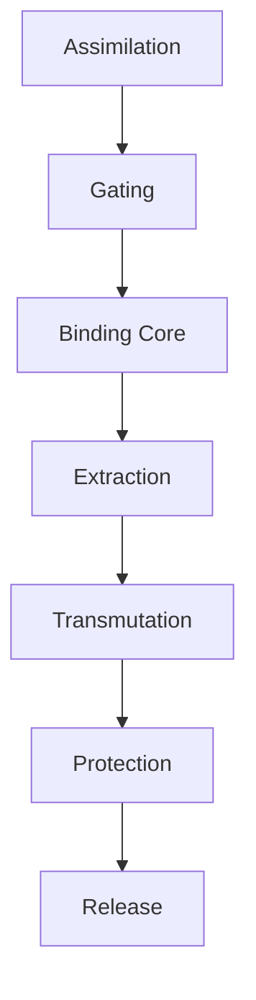

# Alchemical Synthesizer (Brahma)


> **The Brahma Meta-Rack**: A modular alchemical synthesizer designed to absorb, mutate, and re-express the identities of other systems.

> **Three organs live in this repo — see [`ORGANS.md`](ORGANS.md) for the boundary map.**
> **Brahma** — the audio synthesizer engine + Visual Cortex (this README), the shared substrate;
> **[Forge](forge/ORGAN.md)** — the audio → track + visual production pipeline; and
> **[AETHER](aether/README.md)** — the living-radio streaming service. They share the
> Brahma engine but each owns its own lane (`feat(brahma|forge|aether):`); AETHER's boundary and
> current source layout and deployment requirements are declared in [`aether/`](aether/README.md).

**Verification status:** See the [2026-10-24–26 review](docs/reviews/2026-10-24-verification-hardening.md)
for tested behavior, reproduced defects, and the next acceptance milestones. Focused
native DSP, browser, API, broadcast, and packaging checks are distinct from full-rack
hardware operation, listening acceptance, and a deployed commercial service.

---

## Motivation

Traditional synthesizers are fixed voices. The **Alchemical Synthesizer** is a parasitic-symbiotic apparatus. It acquires sonic DNA through contact, records structural traits rather than surface timbre, and recombines those traits under systemic stress.

Modelled after **Rogue (X-Men)** and **The Thing (John Carpenter)**, this instrument is not a tool, but an ethics of contamination.

---

## Architecture: The 7-Stage Organism

Every module in the Brahma Meta-Rack adheres to a strict biological signal path:



1.  **IA (Input Assimilation):** Normalization and protection.
2.  **EG (Equip Gating):** Single-equip constraint state machine.
3.  **BC (Binding Core):** Signal capture and "wearing."
4.  **AE (Analysis Extraction):** Spectral and temporal trait derivation.
5.  **TE (Transmutation Engine):** Operator-based transformation.
6.  **PR (Protection/Reflection):** Sacrificial buffering and retaliation.
7.  **RR (Release Router):** Final routing and bypass logic.

---

## Quick Start

### Prerequisites
- **SuperCollider** (v3.13+)
- **Pure Data** (Vanilla v0.54+) — optional, for performance UI and visual patching
- **Node.js** (v24+) — for Visual Cortex, the workbench, and Foundry
- **Python** (v3.11+) and **ffmpeg** — for validation, rendering checks, and AETHER

### Installation

**From source:** The existing `v1.0.0` release has no attached binary archives as
of this review. Build locally until a verified release bundle is published.
```bash
git clone https://github.com/4444J99/alchemical-synthesizer.git
cd alchemical-synthesizer
```

### Smoke Test (verify it runs)

One command checks the repository's basic integration — no full
SuperCollider / Pd / Live setup required (it validates structure, the Ableton
extension, the Visual Cortex web endpoint, and the audio validator):
```bash
make smoke          # or: bash tools/smoke.sh
```
This is the smoke subset of CI. It does not establish full audio acceptance.
Native tests and prerequisites are in [`tools/dsp/README.md`](tools/dsp/README.md);
CI also runs API, browser, render-wrapper, and packaging regressions. To build the
distributable artifacts locally:
```bash
make dist           # -> dist/alchemical-synthesizer-<version>.{tar.gz,zip} + SHA256SUMS.txt
(cd dist && sha256sum -c SHA256SUMS.txt)
python3 tools/check-release-artifact.py dist/*.tar.gz
python3 tools/check-release-artifact.py dist/*.zip --structure-only
```
Install locked web dependencies before packaging (`npm --prefix brahma/web ci`).
The packer rebuilds the browser bundle, includes tracked working-tree source,
excludes local runtime state, and rejects symlinked sources. A modified checkout
is labelled `source_state: modified`; a distributable release should come from a
clean reviewed commit. The accompanying provenance is unsigned build metadata;
the SPDX file is a top-level component inventory, not a complete dependency SBOM.

### SuperCollider Class Files
All nine recursive `.sc` classes must be visible to the SC class compiler:
```bash
make install
# Or choose the directory reported by Platform.userExtensionDir in the SC IDE:
bash tools/install-brahma.sh --extensions-dir "/absolute/path/to/Extensions"
```
The installer links the complete source directory and checks compilation with a
bounded native script. It migrates only old individual links pointing to the same
source and refuses to replace foreign class files. `--no-recompile` performs the
link step only; recompile an already-open SC IDE with Cmd+Shift+L. FluCoMa is an
optional, separately installed analysis backend; see [its setup guide](docs/setup/fluid-ugens.md).

### Running the Ritual

For a supervised web-only launch, use:

```bash
bash tools/start-brahma.sh --no-sc --no-pd
```

Open the human launch URL printed in the terminal to enable Run, Stop and Panic.
The launcher builds the workbench, checks its own server's readiness, and stops
its child process groups on Ctrl-C. `make start` also requests SC and Pd when
installed; their physical-device and full-rack acceptance remains separate.

1.  Launch **SuperCollider** and evaluate `brahma/sc/loader.scd` (Cmd+Return).
    - Expected: `--- BRAHMA SYSTEM ONLINE ---`
    - A demo patch auto-plays: Prima Materia + MOIRAI melody + Euclidean rhythm + Lorenz modulation + reverb
2.  Launch **Visual Cortex** (optional):
    ```bash
    cd brahma/web && npm ci && npm run build:workbench && npm start
    ```
    - `http://localhost:3000` — **Etz Chaim**: the recursive Tree of Life, and a *universal* synthesizer. Organisms emanate down the Lightning Flash into the ten Sephirot; an Ouroboros coils the cosmos and every illumined vessel contains the Tree again (fractal). **Retune it across four substrates** — `1` Sound · `2` Idea · `3` Product · `4` Cosmos (`T` to cycle) — the one engine re-expressing timbre, thought, value, and worlds through the same vessels (see [`docs/the-universal-synthesizer.md`](docs/the-universal-synthesizer.md)). Self-emanates a demo stream when SuperCollider is silent. Keys: `SPACE` flash · `+/-` recursion depth · `O` ouroboros · `M` multiverse · `D` demo · `H` help.
    - `http://localhost:3000/cortex` — Canvas web patching UI (module browser, drag-drop, cable routing)
    - `http://localhost:3000/golem` — Golem percussion web UI (sequencer, mixer, patchbay)
    - `http://localhost:3000/workbench` — Browser live-coding workbench (multi-buffer CodeMirror + Strudel patterns against Brahma; human/agent approval for AI composition)
3.  Launch **Pure Data** (optional):
    - `brahma/pd/main.pd` — master control surface with OSC bridge
    - `brahma/pd/canvas/brahma_canvas.pd` — Pd-native visual patching via GOP abstractions

The full loader still requires its platform dependencies. On a headless Linux
host without an ALSA MIDI sequencer, the current MIDI initialization blocks full
boot. Passing the isolated dummy-audio tests does not resolve that requirement.

---

## System Overview

### Organisms

| Name | Role | Philosophy |
| :--- | :--- | :--- |
| **Proteus** | The Form-Knower | High-fidelity emulation and observation |
| **Relinquished** | The Parasite | Single-source binding and reflection |
| **Typhon** | The Accumulator | Geometric growth through lossless stacking |
| **Agent Smith** | The Enforcer | Self-replicating signal homogeneity |
| **Ditto** | The Mimic | Identity duplication |
| **Golem** | Percussion Organism | Complete drum machine with sequencer, FX, and web UI |

### Synthesis Engines (10)

| Engine | Type | Character |
| :--- | :--- | :--- |
| **Prima Materia** | Subtractive | Classic analog-style with hard sync, ring mod, unison |
| **Azoth** | FM (4-operator) | DX7-class with 8 algorithms, per-operator envelopes |
| **Quintessence** | Additive (32 harmonics) | Spectral morphing with stretch/spread control |
| **Ouroboros** | Wavetable | Dual-table morphing with position FM |
| **Chrysopoeia** | Phase Distortion | CZ-style with 8 PD waveforms, DCW envelope |
| **Homunculus** | Physical Modeling | Pluck, bow, blow, modal, membrane models |
| **Buchlaeus** | West Coast | Complex oscillator with through-zero FM and wavefolding |
| **Logos** | Formant | 5-formant vowel synthesis with choir mode |
| **Tetramorph** | Vector | 4-corner XY crossfade with 6 source types |
| **Nebula** | Granular | Cloud synthesis with freeze, spray, and buffer grains |

### Module Counts

| Category | Count |
| :--- | :--- | :--- |
| Synthesis Engines | 10 |
| Organisms (Proteus, Relinquished, Typhon, etc.) | 24 |
| Golem Percussion (drums, FX, LFO) | 11 |
| Make Noise Clones | 34 |
| Effects (FX) | 49 |
| Standard Modular | 58 |
| Elektron Machine Emulations | 11 |
| Generative Algorithms | 9 |
| Interaction Controllers | 9 |
| Infrastructure (patch bay, safety, arbitration) | 8 |
| **Total SynthDefs** | **317** |

### Infrastructure

- **Patch Bay**: Universal CV routing via BrahmaModBus (256-bus pool, audio/control rate)
- **CHRONOS**: Full-featured master sequencer (128 tracks, 8 scenes, morph, undo/redo, song mode)
- **Module Registry**: Dynamic SynthDef registration with OSC-addressable create/set/free lifecycle
- **Microtonality**: 16 built-in scales, Scala file import, arbitrary N-TET, custom ratios
- **MIDI/MPE**: 16-voice MPE with per-note expression, MIDI learn, clock sync
- **IMMUNE Governor**: Safety limiter deployed on hardware outputs
- **Presets**: Save/load/morph with project management and undo history
- **Recording**: Multi-track capture, punch-in/out, bounce, WAV export
- **Visual Cortex**: Real-time browser visualization via OSC-to-WebSocket bridge
- **PD Bridge**: Bidirectional SC↔PD communication via OSC (ports 57120/57121)
- **Ableton Bridge**: Live Extension (Extensions SDK, Live 12.4.5+) that absorbs a Live Set as a donor identity — transport sync + the `Ableton` organism (`brahma/ableton/`)

---

## Control Surfaces

The system offers three ways to interact, all connected via OSC:

| Surface | Technology | Entry Point |
| :--- | :--- | :--- |
| **SC IDE** | SuperCollider | `brahma/sc/loader.scd` |
| **Web Canvas** | Browser (p5.js) | `http://localhost:3000/cortex` |
| **PD Canvas** | Pure Data (GOP) | `brahma/pd/canvas/brahma_canvas.pd` |
| **Live Workbench** | Browser (CodeMirror + Strudel) | `http://localhost:3000/workbench` |

The **Web Canvas** provides a Max/MSP-style module browser with drag-drop patching and cable routing. The **PD Canvas** uses Graph-On-Parent abstractions for Pd-native visual patching with a module palette, routing, and parameter control. The **Live Workbench** enables browser-based live coding with AI-assisted composition under human approval.

---

## Productization — The Foundry

The [`product/`](product/) directory is the commercial surface of the engine: a
single Node service exposing accounts, metering, adapters, and specimen records.
`render_specimen` currently creates a simulated record with no audio URL, even
when engine telemetry is observed. Real render completion and artifact ingestion
remain a required integration milestone.

```bash
cd product && npm ci && npm start
# → http://localhost:4000/pricing   (dashboard at /dashboard)
npm run smoke   # local adapter and artifact-serving checks; explicit test billing
```

| Surface | Route | Purpose |
| :--- | :--- | :--- |
| **Dashboard UI** | `/dashboard` | Telemetry, render, catalog, marketplace, API keys, usage |
| **Pricing / waitlist** | `/pricing` | Plans + configured Stripe checkout or explicit local demo billing |
| **REST API** | `/api/v1` | Metered, key-gated, OpenAPI |
| **MCP server** | `/mcp` | JSON-RPC tools for any MCP agent |
| **ACP (both)** | `/acp/runs` · `/acp/jsonrpc` | Agent Communication + Agent Client protocols |

Monetization is layered in logical order — free acquisition → API metering +
licensing → specimen marketplace → accounts/SaaS. See
[`product/README.md`](product/README.md).

### Drive the workbench from Claude, Codex, OpenCode, or agy

The live-coding workbench has its own MCP surface, separate from the Foundry's
catalog MCP: `POST /mcp` on the gateway, and a stdio bridge at
`brahma/web/bin/brahma-mcp.js` that every named client can launch. It drives the
compose loop — propose → human accept → human run — and the agent-role tool list
does not contain `accept` or `run`.

```bash
cd brahma/web && npm start              # writes .runtime/agent-token-<port> (0600)
node bin/brahma-mcp.js                  # stdio; finds the token automatically
```

Setup for each client, the human-role opt-in, and troubleshooting:
[`docs/agent-clients.md`](docs/agent-clients.md).

---

## Technology Stack

- **SuperCollider** (`brahma/sc/`): DSP engine, ~20,000 LOC across 60+ `.scd` files and 6 `.sc` classes
- **Pure Data** (`brahma/pd/`): Performance UI and visual patching, 12 patches (8 core + 4 canvas abstractions)
- **Node.js + p5.js** (`brahma/web/`): Visual Cortex organism viz, Canvas patching UI, Golem percussion UI (~5,500 LOC)
- **Python** (`tools/`): Audio specimen validation
- **Ableton Extension** (`brahma/ableton/`): Node.js/JavaScript Live Extension that streams a Live Set into the rack over OSC
- **OSC**: Bidirectional glue (ports 57120, 57121, 57122)

---

## Development Phases

| Phase | Name | Scope |
| :--- | :--- | :--- |
| **0** | Foundation | Infrastructure, organisms, classes, 7-stage signal path, safety governor |
| **1** | Expansion | 10 synthesis engines, 49 FX, modular suite, Make Noise clones, Elektron emulations, generative systems |
| **2** | Vivification | Module registry, voice manager, Cortex UI, DAEMON-CHRONOS bridge, presets, recording |
| **3** | Canvas (Web) | Browser-based visual patching — module browser, drag-drop canvas, cable routing, parameter editors |
| **3B** | Canvas (Pd) | Pd-native visual patching via GOP abstractions — brahma_module, brahma_route, brahma_palette, brahma_canvas |
| **4** | Live Workbench | Browser live-coding + AI composition with human/agent approval |

---

## Development & Standards

This project follows the **Minimal Root Philosophy** and **Fidelity Stacking Absorption Protocol (FSAP)**.

- **DSP Core**: SuperCollider (`brahma/sc/`)
- **UI Surface**: Pure Data (`brahma/pd/`)
- **Ontology**: Adam Kadmon (`brahma/sc/AdamKadmon.sc`)

See [CLAUDE.md](CLAUDE.md) for detailed architecture documentation, coding conventions, and development tasks. See also [ROADMAP.md](ROADMAP.md) for project milestones and [GEMINI.md](GEMINI.md) for additional architecture context.

### Documentation Surfaces

The project maintains its narrative record across **internal** and **external** surfaces:

- **Logos layer** ([docs/logos/](docs/logos/)) — internal account: [telos](docs/logos/telos.md) (the dream), [pragma](docs/logos/pragma.md) (the honest state), [praxis](docs/logos/praxis.md) (the plan), [receptio](docs/logos/receptio.md) (the reception), and [alchemical I/O](docs/logos/alchemical-io.md).
- **Domain surfaces** ([docs/surfaces/](docs/surfaces/)) — external manifestation: [academic](docs/surfaces/academic.md) (research framing) and [market](docs/surfaces/market.md) (product positioning).

---

## Contributing

Contributions are welcome! Please see [CONTRIBUTING.md](.github/CONTRIBUTING.md) for details on our "Ethics of Contamination" and development workflow.

## License

The repository defaults to [MIT](LICENSE). The browser workbench and its build
tool have an explicit [AGPL-3.0-or-later boundary](brahma/web/public/workbench/README.md).
Dependency notices are retained in its generated bundle.

---

*"Mastery does not come from precision but from learning when to let the instrument consume you back."*

<!-- SYSTEM-NAV-START -->

---

<sub>[Portfolio](https://4444j99.github.io/portfolio/) · [System Directory](https://4444j99.github.io/portfolio/directory/) · [ORGAN II · Poiesis](https://organvm-ii-poiesis.github.io/) · Part of the <a href="https://4444j99.github.io/portfolio/directory/">ORGANVM eight-organ system</a></sub>

<!-- SYSTEM-NAV-END -->
