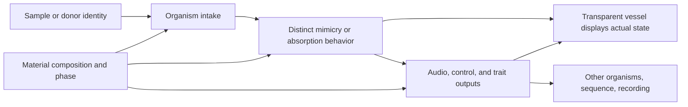

# Brahma: original organisms, shared matter, and the musical universe

Reconciliation: 2026-10-26. Native implementation reference: `3b971f8e849a8e0ca7d4687f299d8575b8241f0d`.
Owner: Brahma instrument / Forge integration, [issue #95](https://github.com/4444J99/alchemical-synthesizer/issues/95).
This document records recovered intent, source inspection, and the next-version
design contract. The material system and behavioral acceptance suite described
below have not been implemented by this documentation change.

## The foundation that carries forward

Brahma hosts an ecology of absorbers, mimics, parasites, fusers, accumulators,
and memory organisms. That is the original premise, already present in the
design conversations. Agent Smith, Rogue / The Thing, Relinquished, Ditto,
Proteus, Typhon, and the sampler creatures are distinct ways of responding to
another identity. The next version must retain those differences. [S01–S09]

The 2026-10-26 direction adds a common material language to that existing
ecology: each module is a transparent vessel; its contents, composition, and
solid/liquid/gas state influence how it receives, transforms, retains, and
releases signals. The glass makes the contents and their activity legible.
The audible transformation and visible response must come from the same state.

The original containment hierarchy calls Brahma the macro-rack: timing,
routing, namespaces, resource accounting, and failure containment support the
organisms within it. Janus and Adam Kadmon originally serve concurrency and
schema roles rather than acting as absorbers themselves. Their support roles
remain meaningful within the shared vessel language. [S03]

## Organisms: intended behavior and inspected implementation

These are source-level findings, not a new listening verdict. The cited native
files establish the narrower implementation described here. They do not prove
the complete organism contract at runtime.

| Organism | Original behavior to preserve | Current source and concrete verification gap |
| --- | --- | --- |
| Rogue / The Thing | Contact extracts sonic structure, dynamics, and modulation topology; Solve dissolves traits; mutation creates antagonistic hybrids; Coagula supplies temporary coherence. Contamination, dominance, and decay matter. [S02] | The source design remains broader than a named standalone kernel. Test acquired traits, their competition and decay across successive contacts; filtering or distortion alone cannot establish this behavior. |
| Proteus | Reversible observation and behavioral emulation; spectral, temporal, modulation, and performance-response traits remain addressable; freeze holds a learned model. [S03, S05] | [`03_proteus_maw.scd`](../../brahma/sc/03_proteus_maw.scd) extracts envelope, centroid, flatness and onset; rendering combines sine and filtered noise. `obsFocus` and `shapeSlope` are declared without implementing their intended behavior there. This is a feature-driven approximation, not measured behavioral isomorphism. |
| MAW | Digest audio/CV/gates into essence, features, and reusable behavioral kernels; Hunger, Bile/Slew and biotype affect digestion. [S04] | The same native file supplies spectral gating and a centroid-derived, sampled/slewed control output. Verify the full declared feature/biotype contract separately. |
| Relinquished | Exactly one equipped donor; deterministic eviction; bind, analyze, transmute, protect/reflect, release; sacrifice the worn donor under defined overload conditions. [S06] | [`04_relinquished.scd`](../../brahma/sc/04_relinquished.scd) contains six stage SynthDefs. Its TE declares six operator amounts but implements OP1–OP4; grain and phase/delay operators are absent there. The equip controller, eviction, priming and fault/reset behavior need a coordinated state-machine test, beyond isolated stage renders. |
| Agent Smith | New instances copy the leader's waveform and phase; dominance broadcasts changes, suppresses local variation, and converges to a shared identity; persistent interference can become the new rule. Seeded behavior is repeatable. [S07] | [`05_agent_smith.scd`](../../brahma/sc/05_agent_smith.scd) supplies a gated bank of eight Pulse voices, low-pass filtering and saturation. It has no donor audio input; computed `ph` is unused. A donor-derived pitch supplied externally is not clone-bus learning, phase copying, or convergence. |
| Ditto | Infer signal morphology, control behavior, and structural role; assume that role imperfectly through structured error; MEMORY retains it; FACE chooses signal/control/structure fidelity. [S08] | [`05_ditto.scd`](../../brahma/sc/05_ditto.scd) uses centroid with a saw/noise kernel, added noise and a dry/kernel blend. Amplitude is calculated but unused. MEMORY, FACE, role inference, and copied control topology are not implemented in this kernel. |
| Fusion Core / Nucleus | Bind carrier/modulator/genome/gatekeeper roles; fuse morphology, physiology and modulation intent; retain parent lineage and a recoverable third identity. Nucleus stores wavetable, envelope, rhythm, stochastic and resonator kernels. [S04] | [`04_fusion_core.scd`](../../brahma/sc/04_fusion_core.scd) cross-modulates two audio streams and supplies a freeze buffer. The freeze voice is not the complete genome store. Test stored kernels and reversible parent/child identity independently of audible cross-modulation. |
| Typhon / FSAP | Observe → absorb → integrate → accumulate; prior layers remain independently addressable and recallable. Coupling grows without baking the identities into one average. Resource refusal or isolation must preserve existing layers. [S03] | [`06_typhon.scd`](../../brahma/sc/06_typhon.scd) implements an audio layer with cross-coupling and limiting. [`FSAP.sc`](../../brahma/sc/FSAP.sc) validates/normalizes observations and appends them to a List. Its fidelity argument is logged, not a demonstrated fidelity measurement. Neither fact proves persistent, concurrent, lossless reconstruction of all layers. |
| Janus | Keep two coherent timelines, switch/blend/mirror/interleave, checkpoint and roll back both; expose their differences without destroying either. [S03] | Verify this against an actual paired-state implementation; Janiform Child's forward/reverse audio kernel is a separate organism and cannot stand in for Janus's complete concurrency contract. |
| Adam Kadmon | Typed trait axes, units, namespaces, explicit coercions and permissions make identities interoperable. [S03] | [`AdamKadmon.sc`](../../brahma/sc/AdamKadmon.sc) supplies contract validation, normalization and provenance. `checkPermission` currently returns true, and its issued identifier is explicitly not signed authorization. Schema validation does not establish permission enforcement or fidelity. |
| Mnemosyne | Contextual, stratified memory and lineage; age, erosion, recall drift and historical adjacency influence recall. [S09] | [`05_sampler_creatures.scd`](../../brahma/sc/05_sampler_creatures.scd) and its [stereo counterpart](../../brahma/sc/05_sampler_creatures_stereo.scd) provide tape-like playback, wow/flutter, filtering and crackle. A loop buffer is not proof of eight contextual archive banks, 20-minute capacity, or contextual recall. |
| Protean Hound | Detect/store attack gestures and 5–500 ms fragments, then recombine by behavioral similarity; aggression, velocity and chaos have distinct effects. [S09] | Native mono/stereo voices continuously record and use onset-driven pointer logic. `aggression` is declared but unused. Verify fragment inventory, similarity-based recombination, and each exposed control. |
| Chrysalid Siren | Transform vocal/spectral bodies through grains, formant contour, multiple morph sources and identity bleed. [S09] | Native voices implement granular playback and position jitter. `formantShift` changes grain playback pitch; that does not establish independent formant shifting, formant analysis, or four-body spectral morphing. |
| Ossuary Monk | Extract impact/resonance into a relic library and procession patterns with meter shift and gravity. [S09] | Native voices excite a fixed resonator bank from amplitude-threshold events. `gravity` shifts resonance frequencies there. Verify captured resonance inheritance and pattern/timing behavior separately. |
| Janiform Child | Concurrent forward/reverse listening, symmetry, phase offset and buffered foreshadowing. [S09] | Native voices provide mirrored buffer reads and a crossfade with drift. Verify independent read-head behavior and boundary cases; buffered pre-echo is distinct from predicting unknown future live audio. |

The digital-clone design is a second, complementary lineage: reproduce observable
control scaling, jack normalization, response curves, slew/envelope timing,
nonlinearities, and modulation artifacts. It explicitly distinguishes circuit
models from behavioral models and proposes steps, ramps, impulses, sweeps,
two-tone and random-CV comparisons. Those requirements remain alongside the
organisms rather than being replaced by their names. [S01]

## Shared material and transparent-vessel contract

The following is an implementation proposal derived from the current direction.
The source conversations do not supply a finished chemistry model or a universal
material-to-DSP equation.

1. **Separate identity from contents.** An instance retains its organism ID,
   donor lineage, processing recipe, and learned traits. Material composition
   and material phase are additional state. Changing contents must not silently
   replace Smith with Ditto or overwrite the original donor.
2. **Share semantics across modules.** A material has a stable ID, composition,
   version and declared response properties. Every organism interprets that
   common material through its own intake, retention, transformation and release
   model. Shared semantics do not imply one global reservoir or identical effects
   in every vessel; global versus per-instance editing remains an explicit design
   decision, not an assumption hidden in the patch.
3. **Give phase actual consequences.** Solid/liquid/gas selects or interpolates
   declared response models. Candidate properties include rigidity/compliance,
   viscosity, damping, diffusion, and persistence. These are artistic model
   parameters until calibrated; phase alone does not prescribe arbitrary EQ,
   pitch, or delay presets, nor establish a scientific fluid simulation.
4. **Publish the mapping.** Each organism/material response profile identifies
   affected engine controls, units, ranges, response curves, transition behavior,
   smoothing, version and supported inputs/outputs. Unsupported combinations
   remain visible with a reason. Every exposed control must have a demonstrated
   effect at the appropriate audio, control or metadata output.
5. **Preserve continuity.** Material changes retain the donor and organism state
   unless a named operation intentionally changes them. Record transition events,
   seeds, buffer/trait identities, and any reset. Click prevention and voice
   release are part of the transition contract.
6. **Drive the glass from engine state.** Display measured intake energy,
   retained content, circulation/diffusion, release and contention where those
   quantities exist. A renderer may interpret them artistically, but it must
   distinguish engine measurements from simulated ornament. Labels, meters and
   accessible controls keep the state legible alongside transparency and motion.
7. **Save the whole playable state.** Portable projects need composition,
   material phase, mapping version, organism recipe/state, donor hashes, chops,
   routes, automation, retained trait layers and reproducible randomness. Reopen
   must restore what can actually play and identify missing capabilities/assets.

For example, a more persistent material could alter Ditto's retention of an
assumed identity, Smith's convergence response, or Mnemosyne's recall coupling.
These are different experiments on a shared property. They are candidate
mappings requiring comparison, not claims about present DSP.

Use distinct names for **material phase**, oscillator phase, and the existing
`readable / cluster / dispersal` compositional cycle. The latter is already
serialized as `phase` in the [sample project](../../brahma/web/public/instrument/sample-project.js);
adding matter state requires a compatible schema migration, not reusing that
field with a different meaning.

## The Claude drum machine remains part of the instrument

The checked-in [conversation](../absorb-alchemize/Remix-of-Interactive-Drum-Machine-with-Claude-API.md)
contains eight user turns, nine assistant turns, and eight code artifacts. Its
final [React artifact](../absorb-alchemize/synth-drum-machine.tsx) was inspected as
source. Earlier code variants are retained in the transcript and inventoried;
this review does not claim execution or a complete regression audit of them.
The original requirements carry forward as follows. [C01, C02]

| Requirement family | Detail that must survive integration |
| --- | --- |
| Track architecture | Add/remove tracks; each track is a full synth machine; later expanded to Synth A + Synth B + Sample A + Sample B with four-way blending and interaction. |
| Synthesis and shaping | Subtractive, FM, additive, noise/physical percussion, Karplus-style and wavefold paths; oscillator frequency/wave/detune; amp and filter ADSR; filter type/cutoff/resonance/envelope amount; synthesis-specific controls and harmonic editing. Wavetable and broader physical models also appear as proposals, not verified delivered engines. |
| Timing and sequencing | Independent 4–64 step lengths, different time signatures/divisions, per-step parameter locks and their indicators, velocity dragging, swing, probability and velocity/timing/pitch humanization. Independent length is not the same feature as independent meter. |
| Sampling and recording | Phone/live microphone capture, sample import, start/end trim, pitch, reverse and filter controls; continuous performance/event capture while playing and building a set; actual MIDI-file export with meaningful timing and events. |
| Modulation | Three LFOs per track (0.1–20 Hz, shape and phase); envelope, random, step position, velocity and XY; cross-track/other-source modulation, audio follower, bipolar amounts and removal; A↔B modulation, ring/AM and cross-filter ideas. |
| Effects and automation | Per-track reverb mix/decay, delay time/feedback/mix, bitcrush, drive; editable automation lanes and copy/paste of patterns plus automation. |
| Performance and arrangement | Scenes/variations, mute groups, solo/mute, editable names, mixer level/pan/master, drum pads, configurable XY destinations; scene chaining and song arrangement remain separately identifiable proposals. |
| Presets and assistance | Factory drum recipes, editable saved engine presets, session restore; requested AI text-to-beat, variation and fill generation, genre shortcuts and proposed modulation generation. These are preserved requirements, not permission to activate a paid service. |
| Interface | Touch tap/drag/long-press without a right-click dependency; 44 px target proposal and 56 px transport proposal; visible feedback, responsive hierarchy, collapsible sections, amp/filter displays; six views: Sequencer, Engine, Patchbay, Mixer, Automation, Perform. |
| Visual language | SVG curved cables, endpoints, patch colors/thickness, live dashed preview, glow and XY crosshairs; seven requested themes: Midnight, Vaporwave, Terminal, Sunset, Arctic, Neon, Earth. A glass-vessel view must retain an intelligible way to inspect and edit the actual connections. |

The transcript's final historical audit reports “107 / 91 / 16” and 85% coverage.
Those are assistant-authored historical counts, not verified current coverage.
The final artifact itself contradicts several broad completion claims:

- Session saving explicitly replaces Sample A/B buffers with `null`. Playback
  also JSON-clones engine state; that does not preserve an `AudioBuffer`. A saved
  sample name is therefore not proof of recoverable sample audio.
- `xmod`, `filterEnv`, sample `reverse`, and pitch-humanization fields exist,
  but the corresponding complete processing paths are not established by those
  fields. The synthA/synthB modulation sources are absent from `applyMod`'s switch.
- Step length defaults to 16 without a step-length editor; filter ADSR, sample
  reverse/filter editing, additive harmonic editing, and cross-modulation need
  complete UI-to-engine paths. The final theme dictionary has five themes.
- The MIDI writer uses fixed note 60 and a fixed millisecond conversion, without
  encoding the full performance parameter/tempo state. Live pad calls go directly
  to `playTrack`, while recording occurs in `playStep`; continuous capture of all
  performance gestures is therefore not demonstrated.
- The patchbay uses a common `1000` scaling and clamps results at zero across
  differently dimensioned destinations; a typed per-destination mapping is still
  needed. Automation also assumes a common 0–20,000 display range. The touch
  target claims require actual measurement; several controls are smaller in source.

The newer browser sampler already has a portable asset/recipe path described in
the [song workflow](song-sampling-album-workflow.md). Use that existing home for
the integrated track state and retained audio. Do not transplant the older
monolithic React artifact and inherit its persistence assumptions.

## Related repositories and what they contribute

These public sources were read remotely at the pinned revisions below. Proposed
relationships are synthesis from those sources; no cross-repository runtime,
deployment, or performance was executed in this review.

| Source | Contribution to the same universe | Evidence boundary |
| --- | --- | --- |
| [Universal Node Network](https://github.com/organvm-iv-taxis/universal-node-network/tree/3f5c50236a2ff81be1ae427fd551f7ea0e146b39) [R01] | Stable node identity, capability descriptions, topology and explicit routes are useful for organism discovery, typed ports and a visible patch graph. Its hierarchy topology is another cross-scale conceptual source. | [`node.py`](https://github.com/organvm-iv-taxis/universal-node-network/blob/3f5c50236a2ff81be1ae427fd551f7ea0e146b39/src/node.py) and [`network.py`](https://github.com/organvm-iv-taxis/universal-node-network/blob/3f5c50236a2ff81be1ae427fd551f7ea0e146b39/src/network.py) store nodes/routes and filter online capabilities. A route's latency is supplied data. This is not measured audio transport or sample-accurate scheduling. |
| [Universal Waveform Explorer / Aether Canvas](https://github.com/organvm-ii-poiesis/universal-waveform-explorer/tree/756c39f571e284103146263f79e3a33e73b6ad6d) [R02] | The [2025-07-04 master design](https://github.com/organvm-ii-poiesis/universal-waveform-explorer/blob/756c39f571e284103146263f79e3a33e73b6ad6d/aether-canvas-the-universal-waveform-explorer.md) supplies mobile 3D orrery interaction, orbital rate/depth modulation, explicit audible-output links, undo/redo, Residue/Nature/Swarm/Lens/Compound concepts, environmental CV, JSON patches and accessibility requirements. These complement glass vessels and scale navigation. | The inspected `src/index.ts` only prints a version. WebGL/WebAudio, camera optical flow, biofeedback, <10 ms latency and about 20 modules are design/target statements, not working integrations demonstrated here. |
| Waveform symbolic architecture [R03] | [64 dialectic spectra, 32 binary exclusions, 15 conditional states, FX archetypes and cross-media modulation](https://github.com/organvm-ii-poiesis/universal-waveform-explorer/blob/756c39f571e284103146263f79e3a33e73b6ad6d/universal-system-architecture.md) supply a vocabulary for continuous versus discrete controls and structure/time/relation/response mappings. | A symbolic property is not automatically a physical material or an implemented DSP control. Preserve the original matrices and IDs; define explicit adapters instead of conflating them with chemistry. |
| [Metasystem / Omni-Dromenon](https://github.com/organvm-ii-poiesis/metasystem-master/tree/795426ae58ae30ba42de2ed43c89fc092818390e) [R04] | Audience/performer parameter aggregation, performer override, SDK interfaces, generative-music examples and integration package boundaries could support participatory performance downstream of the instrument. | The [current README](https://github.com/organvm-ii-poiesis/metasystem-master/blob/795426ae58ae30ba42de2ed43c89fc092818390e/README.md) distinguishes core computation evidence from deployment/rehearsal. The [audio bridge](https://github.com/organvm-ii-poiesis/metasystem-master/blob/795426ae58ae30ba42de2ed43c89fc092818390e/packages/audio-synthesis-bridge/README.md) describes in-memory voices and a legacy string parser, not actual browser audio or binary OSC transport. It cannot be adopted as a proven audio bridge. |

Brahma already has a module registry, OSC paths, a bridge/router and source-owned
trait contracts. Adapt useful external concepts to those owners. File discovery,
topology, audio rendering, transport acknowledgement and artistic acceptance
remain different milestones. Historical registry consolidation notes help find
successors to old music examples; they do not prove that all old behavior survived.
Private consolidation sources are not copied into this public design document.

## Demonstrate what every module actually does

Extend Forge's existing [audition workflow](../../forge/ASSIMILATION.md), native
module catalogue and measurements. The present catalogue describes 245
definitions: 224 standalone audition paths and 21 that require their owning
lifecycle. Those are roles and patches, not 245 proven organism behaviors.
Generators may be driven from donor features, control utilities may be sonified,
and two-input auditions currently receive the same donor at both inputs.

Every definition needs an explicit outcome in the behavioral ledger: demonstrated,
failed, not yet measured, or requires a named coordinated patch. Retain the
infrastructure and control roles visibly; do not reduce the denominator to audio
processors to manufacture complete coverage.

For each organism or declared processing role:

1. Define its source-derived claim and the exact SynthDef/controller/routing
   needed to exercise it. Identify whether it transforms audio, derives control,
   learns traits, generates a donor-driven voice, routes state, or stores identity.
2. Feed the same hashed excerpt and matched synthetic probes. Preserve the
   original and actual processed output. Use isolated donor A/B inputs where
   imitation, dominance, memory or fusion depends on distinguishing sources.
3. Compare original, processed and bypass at documented gain. Keep raw peak/RMS
   measurements and playback normalization separate. Audibility is one check;
   the intended change requires its own measurement and listening comparison.
4. Sweep exposed controls and record their effect, units and state changes.
   Exercise silence, onset-rich audio, sustained tone/noise, source removal,
   replacement, repeated capture and boundary settings appropriate to that role.
5. Test the organism-specific invariant: Smith convergence after perturbation;
   Ditto role/gesture copying and retention; Relinquished single-equip/eviction;
   Typhon independent prior-layer recall; Hound fragment extraction; Siren pitch
   versus formant independence; Monk inherited resonance versus its fixed bank;
   Janiform forward/reverse symmetry; Janus paired rollback.
6. Repeat with a changed material and with phase transitions, holding the donor
   and organism recipe fixed. Correlate engine output and displayed vessel state.
   Compare the same material across different organisms without demanding the
   same sound from them.
7. Save/reopen the patch and export it, binding donor hashes, seed, parameters,
   material/mapping versions, control traces, measurements and output hashes to
   the exact code revision. Test stop, reset, cancellation and original recall.
8. Record performer listening/interaction acceptance separately. A plausible
   model and a passing signal test do not establish the desired musical result.

The first bounded comparison should exercise Relinquished, Smith, Ditto and
Typhon/FSAP: they expose capture, replication, imperfect mimicry and cumulative
retention as clearly different operations. The full catalogue stays in scope;
this first group establishes a reusable comparison format rather than replacing
the rest of the required ledger.

## Conflicts and source coverage that remain explicit

- **Clockless versus clocked:** the Proteus/Cronus conversation rejects a master
  tempo, while the fusion and Brahma conversations specify a clock/transport.
  Preserve free/event-driven organism time within a host that can also provide
  sequencing; the exact synchronization adapter still needs implementation.
- **Decay versus preservation:** Rogue/Thing and archival sound aging allow
  decay, while FSAP requires prior traits to remain recoverable. Keep immutable
  source/trait records separate from an organism's intentionally changing
  audible expression. Do not apply one memory policy to every organism.
- **Irrepeatability versus portable projects:** the Rogue/Thing source describes
  amnesia and unrepeatable specimens; other sources request seeded recall,
  snapshots and lossless accumulation. Treat destructive expression as an
  explicit performance mode over preserved provenance, not silent project loss.
- **Physical hardware versus software:** the sampler source contains HP layouts,
  power/CV proposals, 32-byte metadata, 12-byte bridge frames, TTLs, paired links
  and loopback rules. These remain preserved design records, not certified
  electrical specifications or proof that the software bridge enforces them.
  Its later paired-link rule sets UNI on each emitted direction, superseding the
  earlier suggestion to leave UNI clear on the wire.
- **Scope of originals:** nine checked-in design conversations and the Claude
  drum-machine export are identified below. No project-complete ChatGPT/Claude
  provider inventory or export manifest was recovered in this review. Searchable
  Pages are not a complete conversation archive. Earlier Claude code variants
  and all provider branches/attachments still need coverage reconciliation.
  This is a source-grounded continuation, not an exhaustive provider-history audit.

The remaining work stays with issue #95 and this design lane: obtain authoritative
provider title/ID coverage, reconcile missing originals and earlier code variants,
implement the behavioral ledger and material mappings, then verify the integrated
performance workflow. None of those gaps is marked complete by this report.

## Sources

The [source inventory](mimicry-material-source-inventory.json) records local byte
hashes, turn counts and remote revision bindings. Counts identify source units;
they are not proof of semantic or provider completeness. Original conversations
remain intact in their existing homes.

| ID | Existing source | Principal correspondence |
| --- | --- | --- |
| S01 | [Digital clones / Pd and SuperCollider](alchemical-synthesis-Digital-Clones-Design-Guide.md) | Observable behavior, common control schema, calibration and test stimuli |
| S02 | [Rogue / The Thing](alchemical-synthesis-Modular-Synthesizer-Design.md) | Contact, Solve, mutation, Coagula, contamination and decay |
| S03 | [Fidelity stacking and Brahma containment](alchemical-synthesis-Fidelity-Stacking-Synth-Design.md) | FSAP, Proteus, Typhon, Janus, Adam Kadmon and explicit invariants |
| S04 | [Absorption / fusion](alchemical-synthesis-Absorption-Fusion-Synth-Design.md) | MAW, Nucleus, Fusion Core, Immune, Metabolism and genomes |
| S05 | [Proteus / Cronus](alchemical-synthesis-Modular-Synth-Absorption-Design.md) | Mutable assimilation, temporal capture, succession and clockless variant |
| S06 | [Relinquished process and strict specification](alchemical-synthesis-Relinquished-monster-process.md) | Seven stages, single equip, state machine, fault modes and calibration |
| S07 | [Agent Smith](alchemical-synthesis-Agent-Smith-Synth-Design.md) | Phase/identity cloning, dominance, propagation and convergence |
| S08 | [Ditto](alchemical-synthesis-Modular-Synth-Ditto-Design.md) | Morphology/control/role observation, structured error, memory and FACE |
| S09 | [Anthropomorphized sampler creatures](alchemical-synthesis-Anthropomorphized-Sampler-Creatures.md) | Five creatures, typed I/O, recursive absorption, domains and bridge protocol |
| C01 | [Claude drum-machine conversation](../absorb-alchemize/Remix-of-Interactive-Drum-Machine-with-Claude-API.md) | Eight user turns, successive artifacts and historical feature audit |
| C02 | [Final drum-machine React artifact](../absorb-alchemize/synth-drum-machine.tsx) | Static code correspondence and retained implementation gaps |
| R01–R04 | Pinned public repository links above | Read-only repository relationships and implementation limits |
